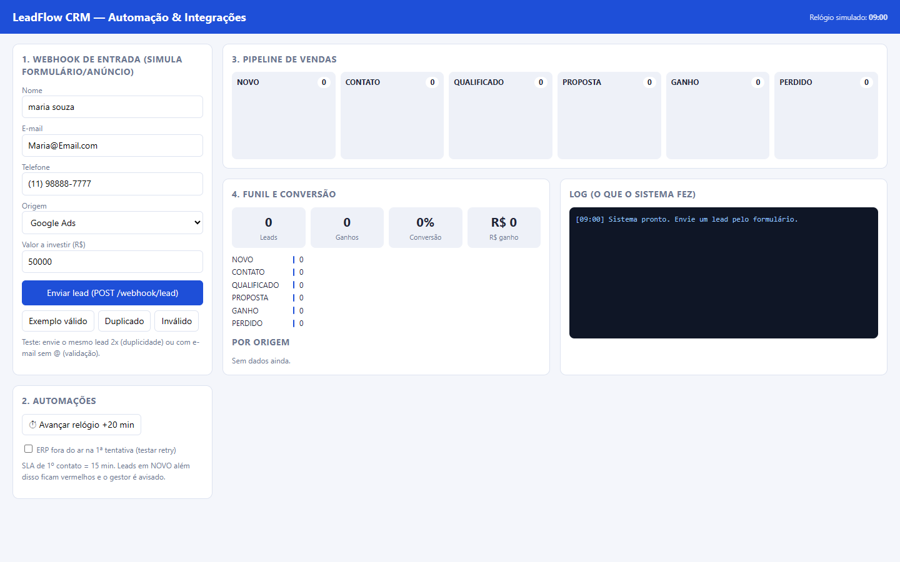
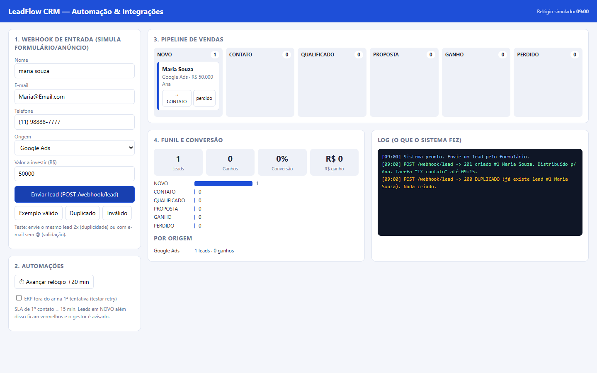
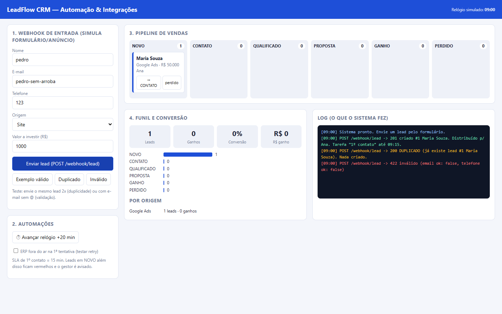
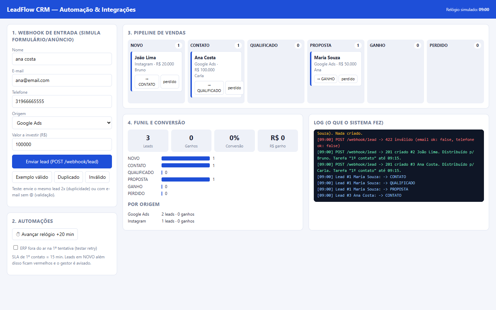
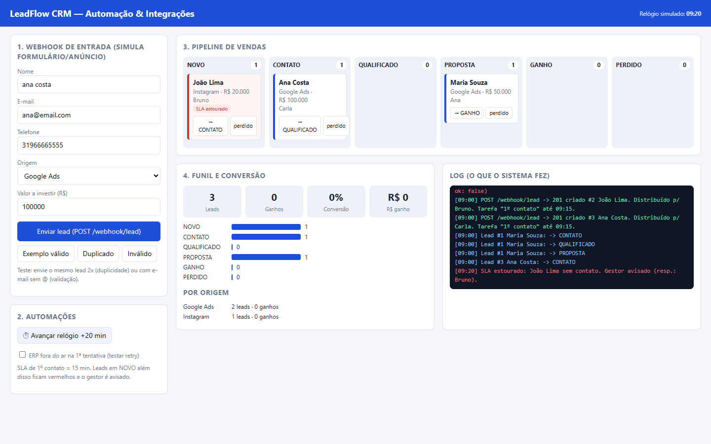
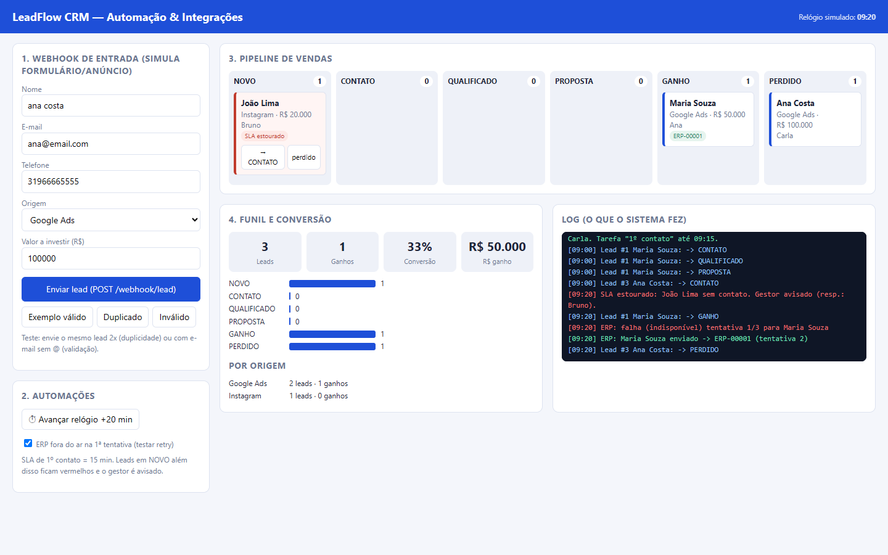

# LeadFlow CRM

Mini CRM que simula, de ponta a ponta, o ciclo de um lead: **entrada por webhook, higienização dos dados, bloqueio de duplicidade, distribuição entre vendedores, pipeline de vendas, SLA de contato, integração com ERP e relatório de funil**.

É um projeto de estudo para demonstrar automação de processos comerciais e integração entre sistemas. Tudo roda localmente, sem dependências externas.

## Tecnologias

| Parte | Tecnologia |
|---|---|
| Interface web (página única) | HTML, CSS e JavaScript puro |
| Versão em linha de comando | Python 3 (somente biblioteca padrão: `sqlite3`, `http.server`, `re`, `datetime`) |
| Armazenamento da versão Python | SQLite (em memória) |

## O que o sistema faz

1. **Webhook de entrada:** recebe o lead (nome, e-mail, telefone, origem, valor) como um formulário ou anúncio enviaria.
2. **Qualidade dos dados:** valida o e-mail, padroniza o telefone (só dígitos, sem `+55`) e formata o nome.
3. **Deduplicação:** se o e-mail ou o telefone já existir, o lead não é criado de novo.
4. **Distribuição:** divide os leads entre os vendedores em rodízio (round-robin).
5. **Tarefa com SLA:** cada lead novo gera a tarefa "1º contato" com prazo de 15 minutos.
6. **Robô de SLA:** quem não foi contatado no prazo é marcado como atrasado e o gestor é avisado.
7. **Pipeline:** NOVO → CONTATO → QUALIFICADO → PROPOSTA → GANHO ou PERDIDO.
8. **Integração com ERP:** ao virar GANHO, o cliente é enviado ao ERP com tentativas automáticas (retry) e sem duplicar o envio (idempotência).
9. **Relatório:** quantidade de leads por etapa, taxa de conversão, valor ganho e desempenho por origem.

## Como rodar

**Versão web:** abra o arquivo `index.html` no navegador.

**Versão Python (terminal):**

```bash
python crm_demo.py          # executa uma demonstração completa
python crm_demo.py server   # sobe o webhook em http://localhost:8000/webhook/lead
```

Exemplo de chamada ao webhook:

```bash
curl -X POST http://localhost:8000/webhook/lead \
  -H "Content-Type: application/json" \
  -d '{"nome":"maria souza","email":"maria@email.com","telefone":"11988887777","origem":"Google Ads","valor":50000}'
```

## Passo a passo

### 1. Tela inicial
Formulário do webhook, automações, pipeline, funil e log do que o sistema faz.



### 2. Lead recebido pelo webhook
O lead é validado, normalizado, atribuído a um vendedor e ganha uma tarefa de 1º contato.


### 3. Lead duplicado é bloqueado
Reenviar o mesmo lead não cria outro registro.



### 4. Dados inválidos são rejeitados
E-mail sem `@` e telefone curto retornam erro 422.



### 5. Pipeline de vendas
Os leads avançam pelas etapas do funil.



### 6. SLA de contato estourado
Passados 15 minutos sem contato, o lead fica vermelho e o gestor é avisado.



### 7. Integração com ERP e retry
Ao fechar a venda, o cliente é enviado ao ERP. Se a primeira tentativa falha, o sistema tenta de novo.


### 8. Funil e conversão
Indicadores atualizados: leads, ganhos, taxa de conversão, valor ganho e resultado por origem.



## Conceitos aplicados

- **Webhook vs API:** o sistema externo avisa o CRM quando algo acontece, em vez de o CRM ficar perguntando.
- **Idempotência:** repetir a mesma operação não gera duplicatas.
- **Retry:** falhas temporárias de integração são tentadas de novo antes de desistir.
- **Qualidade de dados:** normalizar antes de comparar evita leads duplicados.
- **SLA:** prazo para o 1º contato, monitorado por um robô.

## Limitações e próximos passos

- Os dados vivem em memória: ao recarregar a página ou reiniciar o script, eles se perdem.
- O ERP é simulado. Em produção, a chamada seria uma requisição HTTP para a API real.
- Faltam a fila persistente de reprocessamento e o alerta quando todas as tentativas de envio ao ERP falham.
- Ideias: persistência em banco real, autenticação no webhook e notificações por e-mail ou chat.
